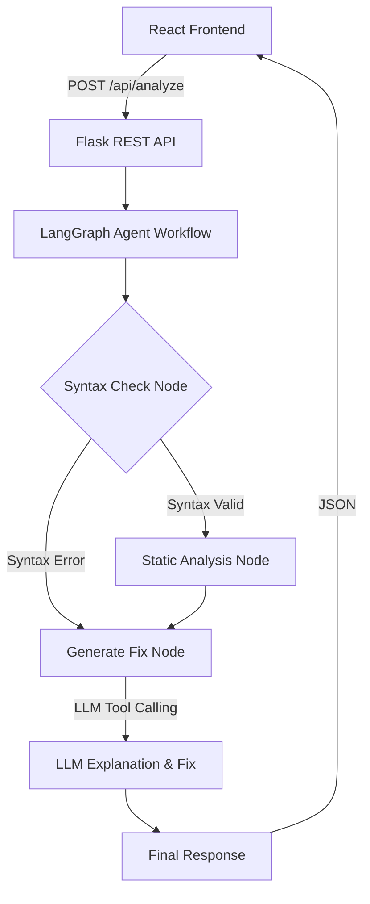

# AI Code Review & Bug Fixing Agent

An Agentic AI application built for code review and bug fixing. It takes Python code as input, checks for syntax and logic issues, and uses an LLM to explain problems and generate a suggested fix.

## Problem Statement
Finding simple bugs, syntax errors, and poorly structured logic in Python code can be tedious. Fresher developers and students need an automated tool to review their code, explain why it's failing, and show how to fix it, mimicking an experienced reviewer.

## Solution
This project implements an AI-powered agent workflow using LangGraph and LangChain. When code is submitted, the agent sequentially executes syntax validation, static analysis, and then passes the context to an LLM to generate plain-English explanations and corrected code snippets.

## Features
- **Automated Syntax Checking**: Uses Python's built-in `ast` module safely (no arbitrary code execution).
- **Static Analysis**: Identifies missing docstrings, suspicious logic, etc.
- **Agentic Workflow**: A LangGraph state machine dynamically routes execution. If syntax fails, it skips deeper static analysis and jumps straight to generating a fix.
- **LLM Code Fixes**: Connects to OpenAI's GPT models to synthesize explanations and fixes.
- **REST API**: Flask backend providing a clean API.
- **Interactive UI**: A React frontend to seamlessly interact with the agent.

## Architecture



## Technology Stack
- **Backend**: Python 3, Flask, pytest
- **Generative AI**: LangChain, LangGraph, OpenAI API (gpt-3.5-turbo)
- **Frontend**: React.js (Vite), CSS
- **Tools**: Python `ast` for static analysis

## Agent Workflow & Tool Calling
This application doesn't just pass text to an LLM. It uses a **LangGraph StateGraph**:
1. **State**: The graph maintains `AgentState` containing the code, issues list, and status.
2. **Tools**: We implemented deterministic tools (`check_python_syntax`, `analyze_python_code`) that the agent executes before generating a response.
3. **Routing**: Conditional edges in the graph decide the execution path. For example, if syntax is invalid, it skips logical analysis.
4. **LLM Synthesis**: The LLM receives the strict output of the deterministic tools and provides a human-readable fix.

## Setup & Installation

### 1. Backend Setup
```bash
cd backend
python -m venv venv
# Activate the venv
# Windows: venv\Scripts\activate
# Mac/Linux: source venv/bin/activate

pip install -r requirements.txt
```

### 2. Environment Variables
Create a `.env` file in the root directory (copy from `.env.example`):
```
OPENAI_API_KEY=your_actual_api_key
```

### 3. Run Backend
```bash
cd backend
python app.py
# Runs on http://localhost:5000
```

### 4. Frontend Setup
```bash
cd frontend
npm install
npm run dev
# Runs on http://localhost:5173
```

## Example Inputs to Test
- **Syntax Error**:
  ```python
  def hello()
      print("Hello")
  ```
- **Logic Error**:
  ```python
  numbers = [1, 2, 3]
  print(numbers[5])
  ```
- **Valid Code**:
  ```python
  def add(a, b):
      return a + b
  ```

## Future Improvements
- Support for more programming languages.
- Integration with `flake8` or `mypy` as additional tools.
- Multi-agent setup (one agent reviews security, another reviews performance).
- Integration into GitHub Actions as an automated PR reviewer.
