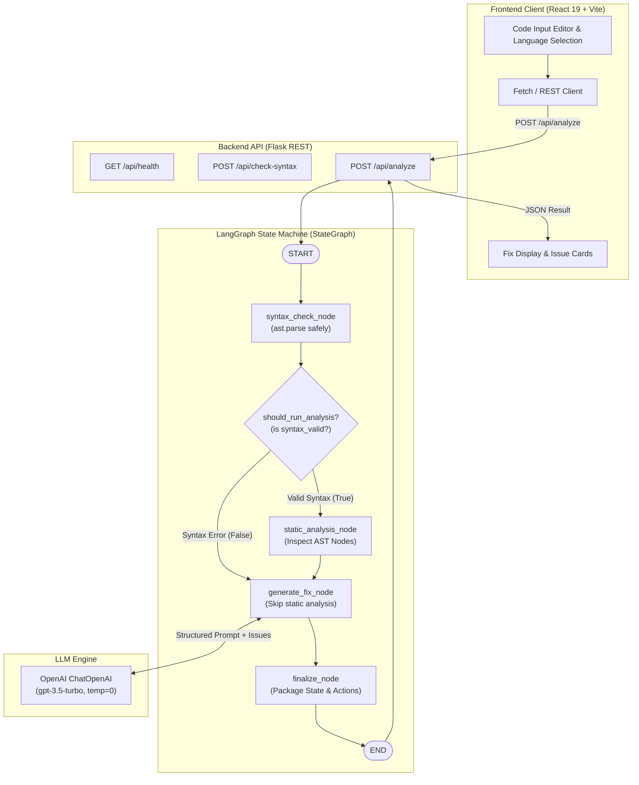

# 🤖 AI Code Review & Bug Fixing Agent

[](https://www.python.org/)
[](https://flask.palletsprojects.com/)
[](https://github.com/langchain-ai/langgraph)
[](https://www.langchain.com/)
[](https://openai.com/)
[](https://react.dev/)
[](https://vitejs.dev/)
[](https://docs.pytest.org/)

> An Agentic AI web application built with **React**, **Flask**, **LangGraph**, **LangChain**, and **OpenAI GPT**. The system evaluates submitted code through a deterministic state machine, running safe AST syntax checks and static analysis before routing context to an LLM for structured explanations, actionable bug fixes, and code optimizations.

---

## 🎯 Problem Statement & Solution

### The Challenge
Debugging syntax errors, unhandled edge cases, and logic flaws in code often leaves student developers and junior engineers stuck in tedious trial-and-error loops. Traditional linters produce cryptic error strings without semantic explanations, while naive LLM chat interfaces lack execution guardrails, hallucinate on simple syntax rules, and burn expensive API tokens on code that cannot even compile.

### The Agentic Solution
This project implements an intelligent **LangGraph StateGraph** pipeline:
1. **Zero-Token Syntax Pre-Check:** Safely parses source code using Python's native `ast` module.
2. **Conditional Path Routing:** If syntax is broken, the agent bypasses deep semantic analysis and immediately guides the LLM to fix the syntax error.
3. **Deterministic Static Inspection:** Detects missing docstrings, dead code, and suspicious patterns before LLM invocation.
4. **Structured JSON Fix Generation:** Prompts OpenAI GPT with strict JSON schemas to deliver structured explanations, clean drop-in code fixes, and itemized optimization tips.
5. **Interactive UI:** Provides a responsive React single-page interface for live submission and side-by-side inspection.

---

## 🏗️ System Architecture & LangGraph Workflow



---

## 🧠 LangGraph State Machine Specification

The state graph manages execution context using a typed dictionary across every node:

```python
class AgentState(TypedDict):
    code: str                  # Original source code string
    syntax_valid: bool         # Boolean flag from AST validator
    issues: List[str]          # Discovered syntax & static issues
    explanation: str           # Plain-English diagnosis
    suggested_fix: str         # Corrected, runnable code block
    improvements: List[str]    # Additional best practice suggestions
    agent_actions: List[str]   # Audit log of agent lifecycle steps
```

### Graph Nodes & Conditional Routing
- **`syntax_check_node`:** Invokes `tools.code_tools.check_python_syntax`. Uses `ast.parse()` inside a safe `try-except SyntaxError` sandbox. Records exact line numbers and error descriptions.
- **`should_run_analysis` (Conditional Edge):**
  - If `state["syntax_valid"] == True`: Routes to `static_analysis_node`.
  - If `state["syntax_valid"] == False`: Bypasses static analysis and jumps straight to `generate_fix_node`, preventing wasted computation and token overhead.
- **`static_analysis_node`:** Traverses the AST to flag missing docstrings, dangerous bare `except:` clauses, or suspicious infinite constructs.
- **`generate_fix_node`:** Formulates a structured system prompt combining known issues and raw code. Calls `ChatOpenAI(model="gpt-3.5-turbo", temperature=0)` with JSON output enforcement.
- **`finalize_node`:** Appends completion telemetry and prepares the output dictionary.

---

## 📁 Repository Directory Structure

```
AI-Code-Reviewing-Agent/
├── backend/
│   ├── agents/
│   │   ├── __init__.py
│   │   └── code_agent.py      # LangGraph StateGraph, nodes, and routing logic
│   ├── routes/
│   │   ├── __init__.py
│   │   ├── analyze.py         # POST /api/analyze & POST /api/check-syntax
│   │   └── health.py          # GET /api/health
│   ├── tools/
│   │   ├── __init__.py
│   │   └── code_tools.py      # Deterministic AST parsing & inspection helpers
│   ├── app.py                 # Flask app factory, CORS setup & blueprint registry
│   └── requirements.txt       # Python dependencies (Flask, LangGraph, LangChain, etc.)
├── frontend/
│   ├── src/
│   │   ├── assets/            # UI icons and graphics
│   │   ├── App.css            # Custom CSS styles
│   │   ├── App.jsx            # Core UI layout, editor & response viewer
│   │   ├── index.css          # Design system variables & resets
│   │   └── main.jsx           # React root mount
│   ├── package.json           # Frontend dependencies & scripts
│   └── vite.config.js         # Vite configuration
├── tests/
│   ├── __init__.py
│   └── test_api.py            # 5 automated pytest test suites
├── .env.example               # Environment template for OPENAI_API_KEY
├── .gitignore                 # Python & Node ignore rules
└── README.md                  # Project technical documentation
```

---

## 📡 REST API Specification

### 1. Health Check
- **Endpoint:** `GET /api/health`
- **Response (200 OK):**
```json
{
  "status": "ok",
  "service": "AI Code Review Agent API"
}
```

### 2. Fast Syntax Check (Zero LLM Tokens)
- **Endpoint:** `POST /api/check-syntax`
- **Request Body:**
```json
{
  "code": "def hello():\n    print('Hello World')"
}
```
- **Response (200 OK - Valid):**
```json
{
  "valid": true,
  "error": null,
  "line": null
}
```
- **Response (200 OK - Invalid):**
```json
{
  "valid": false,
  "error": "expected ':' (line 1)",
  "line": 1
}
```

### 3. Full Agent Analysis & Fix Generation
- **Endpoint:** `POST /api/analyze`
- **Request Body:**
```json
{
  "code": "def divide(a, b):\n    return a / b"
}
```
- **Response (200 OK):**
```json
{
  "syntax_valid": true,
  "issues": [
    "Potential ZeroDivisionError if b == 0",
    "Missing function docstring"
  ],
  "explanation": "The function performs division without verifying if the denominator `b` is zero, which will raise a ZeroDivisionError at runtime.",
  "suggested_fix": "def divide(a, b):\n    \"\"\"Divides two numbers safely.\"\"\"\n    if b == 0:\n        raise ValueError('Denominator cannot be zero.')\n    return a / b",
  "improvements": [
    "Add type hints: `def divide(a: float, b: float) -> float:`",
    "Include exception handling for non-numeric types"
  ],
  "agent_actions": [
    "Checking Python syntax...",
    "Running code analysis...",
    "Generating fix suggestion...",
    "Preparing final response..."
  ]
}
```

---

## 🧪 Automated Testing Suite (Pytest)

The project includes **5 automated test cases** located in [`tests/test_api.py`](tests/test_api.py) verifying pipeline integrity, edge-case validation, and mocked LLM interaction:

| Test Case | Method / Endpoint | Scenario Verified | Expected Assertion |
| :--- | :--- | :--- | :--- |
| `test_health_check` | `GET /api/health` | Service uptime and readiness | Status `200`, `status == "ok"` |
| `test_check_syntax_valid` | `POST /api/check-syntax` | Clean code parsing | Status `200`, `valid == True` |
| `test_check_syntax_invalid` | `POST /api/check-syntax` | Syntax error detection | Status `200`, `valid == False`, error message present |
| `test_analyze_code_valid` | `POST /api/analyze` | Full LangGraph review with mocked `ChatOpenAI` | Status `200`, `syntax_valid == True`, explanation populated, actions logged |
| `test_analyze_no_code` | `POST /api/analyze` | Missing request payload | Status `400 Bad Request` |

### Running the Tests:
```bash
# From the repository root with virtual environment activated:
pytest tests/ -v
```

---

## 🚀 Getting Started Locally

### 1. Prerequisites
- **Python 3.10+**
- **Node.js 18+** and `npm`
- **OpenAI API Key** ([Get one here](https://platform.openai.com/api-keys))

### 2. Backend Setup
```bash
# Navigate to backend directory
cd backend

# Create and activate virtual environment
python -m venv venv

# Windows:
venv\Scripts\activate
# macOS/Linux:
source venv/bin/activate

# Install dependencies
pip install -r requirements.txt
```

### 3. Environment Variables
Create a `.env` file in the project root:
```env
OPENAI_API_KEY=your_openai_api_key_here
```

### 4. Run the Backend API
```bash
python app.py
# Server runs on http://localhost:5000
```

### 5. Frontend Setup
In a new terminal:
```bash
cd frontend
npm install
npm run dev
# Frontend runs on http://localhost:5173
```

---

## 💡 Technical Interview Defense Q&A

**Q1: Why choose LangGraph over a linear LangChain `LLMChain`?**
> *Answer:* Linear prompt chains blindly send raw code to the LLM on every execution, costing unnecessary API tokens and latency even when code has trivial syntax errors. With LangGraph, we model our review pipeline as a cyclical state machine (`StateGraph`). If our deterministic AST validator detects a syntax error, a conditional edge skips the static analysis node and routes straight to targeted syntax remediation, saving latency and OpenAI API costs.

**Q2: How do you prevent arbitrary code execution vulnerabilities during syntax validation?**
> *Answer:* We parse code strictly using Python's built-in `ast.parse()`. Abstract Syntax Tree compilation inspects the code's grammatical structure without executing any bytes of code, avoiding dangerous functions like `eval()` or `exec()`.

**Q3: How do you guarantee deterministic, structured output from the LLM?**
> *Answer:* We instruct the model to respond in strict, schema-validated JSON with explicit keys (`explanation`, `suggested_fix`, `improvements`), and set `temperature=0` to minimize randomness. In the agent node, if JSON parsing fails, fallback handlers extract the raw suggestion to ensure the API never crashes.

---

## 👩‍💻 Author
- **Developer:** Vepada Bhavana
- **GitHub:** [@bhavanajoseph84392-png](https://github.com/bhavanajoseph84392-png)
- **LinkedIn:** [Bhavana Vepada](https://www.linkedin.com)
- **Email:** bhavanajoseph84392@gmail.com
